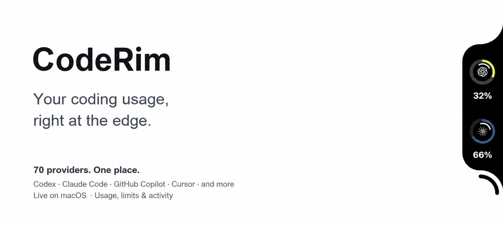

# CodeRim

[English](README.md) · **한국어**

> 화면 가장자리에서 확인하는 코딩 도구 사용 한도.

[](https://github.com/dlfkdLR/CodeRim/actions/workflows/ci.yml) [](https://github.com/dlfkdLR/CodeRim/releases/latest) [](https://github.com/dlfkdLR/CodeRim/actions/workflows/windows.yml)



CodeRim은 작은 가장자리 노치에서 코딩 도구의 사용 한도, 초기화 시각, 세션 활동을 보여줍니다. **네이티브 macOS 앱**과 **Windows 11 앱**을 제공하며 Codex·Claude Code의 로컬 토큰 기록을 별도로 관리합니다.

## 플랫폼별 기능

| 기능 | macOS | Windows |
| --- | --- | --- |
| 제공업체 목록 | 연결 안내 70개 | 연결 구현 70개; 기능 표 참고 |
| 데스크톱 화면 | 메뉴 막대, Settings, 가장자리 노치 | 트레이, Settings, 가장자리 노치 |
| Codex·Claude 로컬 기록 | 토큰·모델·프로젝트·세션, Codex 비용 추정 | 로컬 기록·분석, 플랫폼별 비용 추정 |
| 터미널 CLI | 포함 | 포함 |
| 저장한 계정 | Codex·Claude Code 수동 전환 | Codex·Claude Code 수동 전환 |
| 위젯 | macOS 위젯 | Windows 범위 밖 |
| 업데이트 | Ed25519 검증 Sparkle | 관리형 설치의 검증된 MSI 업데이트, 별도 이전 ZIP 경로 |

로컬 수치는 **이 컴퓨터의 기록을 계정에 관계없이** 집계합니다. 캐시 입력은 이미 입력에 포함됩니다. 누락되거나 원격에만 있는 세션 기록은 이용 불가로 유지합니다. 한도·로컬 토큰·계정 합계·API 환산 비용은 출처가 각각 다릅니다. [사용량 범위](docs/ko/usage.md)에서 구분을 설명합니다. 선택적 [iPhone 공유](docs/ko/iphone.md)는 기기·서명·릴레이·APNs 설정이 별도로 필요합니다.

## 설치

**macOS:** [2.1.36](https://github.com/dlfkdLR/CodeRim/releases/tag/v2.1.36) · **Windows:** [2.1.34](https://github.com/dlfkdLR/CodeRim/releases/tag/v2.1.34)

### macOS

**macOS 14 이상 · Apple silicon과 Intel.**

[](https://github.com/dlfkdLR/CodeRim/releases/download/v2.1.36/CodeRim-2.1.36.dmg)

```sh
brew tap dlfkdLR/tap &&
brew install --cask dlfkdLR/tap/coderim
```

앱은 **ad-hoc 서명이며 Apple 공증을 받지 않았습니다**. [설치·첫 실행](docs/ko/installation.md)에서 체크섬·macOS 승인·CodexMeter 이전을 확인합니다. Homebrew가 cask나 이전 앱을 찾지 못하면 [복구 안내](docs/ko/troubleshooting.md#homebrew-cannot-find-the-coderim-cask)를 따릅니다.

**Settings → Providers → Add Provider**에서 도구를 연결하고 링에 포인터를 올립니다. [시작하기](docs/ko/getting-started.md).

### Windows

**Windows 11 · x64·ARM64 · .NET 포함.**

[](https://github.com/dlfkdLR/CodeRim/releases/download/v2.1.34/CodeRim-Windows-2.1.34-x64-Setup.msi) [](https://github.com/dlfkdLR/CodeRim/releases/download/v2.1.34/CodeRim-Windows-2.1.34-arm64-Setup.msi)

MSI를 실행한 뒤 시작 메뉴에서 CodeRim을 엽니다. 관리자 권한 없이 내 계정에 설치되고 `coderim` 명령이 추가되며, 이후 릴리스는 검증을 거쳐 자동으로 업데이트됩니다([x64 SHA-256](https://github.com/dlfkdLR/CodeRim/releases/download/v2.1.34/CodeRim-Windows-2.1.34-x64-Setup.msi.sha256) · [ARM64 SHA-256](https://github.com/dlfkdLR/CodeRim/releases/download/v2.1.34/CodeRim-Windows-2.1.34-arm64-Setup.msi.sha256)).

MSI에는 아직 게시자 인증서 서명이 없어 **Windows의 PC 보호** 창이 뜰 수 있습니다. **추가 정보 → 실행**을 선택하세요. 스마트 앱 컨트롤이 서명 없는 설치 파일을 막는 PC에서도 설치되는, Microsoft가 서명한 Microsoft Store 버전을 준비하고 있습니다. 무료 코드 서명을 위해 SignPath Foundation 신청을 준비하고 있으며, **아직 제출·승인되지 않았고** 그 인증서로 서명된 파일은 없습니다. [코드 서명 정책](CODE_SIGNING_POLICY.ko.md)을 참고하세요. 업그레이드·CLI·Store 버전은 [Windows 설치](docs/ko/windows.md)에서 확인합니다.

**Settings → Providers → Add Provider**에서 한 번 로그인한 뒤 링에 포인터를 올립니다.

## macOS 제공업체

각 연결 안내를 제공하는 **70개 제공업체**입니다. [전체 목록](docs/ko/providers.md) · [Windows 기능 표](Documentation/WINDOWS.ko.md#remaining-parity-work).

## 문서

[사용자 문서](docs/ko/README.md) · [개발 문서](Documentation/README.ko.md) · [기여](CONTRIBUTING.ko.md) · [변경 이력](CHANGELOG.md) · [보안](SECURITY.ko.md)

소스 빌드는 [기여 안내](CONTRIBUTING.ko.md)에 따라 고정된 의존성의 수정본을 준비한 뒤 Swift 테스트를 실행합니다. CI와 릴리스 빌드는 Swift 컴파일 경고가 있으면 실패합니다.

## 출처와 라이선스

[MIT](LICENSE). 가장자리 노치 화면과 지원 코드에는 [Codenotch](https://github.com/vinzdg/codenotch)의 **MIT © 2026 Vinz** 부분이 포함됩니다. 제공업체 통합에는 [CodexBar](https://github.com/steipete/CodexBar), 업데이트에는 [Sparkle](https://sparkle-project.org/)를 사용합니다. 재배포 시 [LICENSE](LICENSE)와 [NOTICE](NOTICE)를 보존합니다.

CodeRim은 OpenAI·Anthropic과 제휴하거나 보증받지 않은 비공식 유틸리티입니다.
