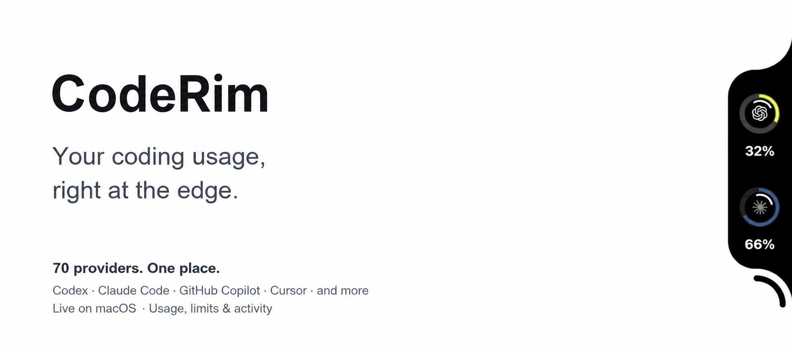

# CodeRim

**English** · [한국어](README.ko.md)

> Coding-assistant limits at the edge of your screen.

[](https://github.com/dlfkdLR/CodeRim/actions/workflows/ci.yml) [](https://github.com/dlfkdLR/CodeRim/releases/latest) [](https://github.com/dlfkdLR/CodeRim/actions/workflows/windows.yml)



CodeRim keeps coding-assistant usage limits, reset times, and session activity visible in a small edge notch. It is a native **macOS app** and a **Windows 11 app**, with separate local token history for Codex and Claude Code.

## Features by platform

| Feature | macOS | Windows |
| --- | --- | --- |
| Provider catalogue | 70 setup guides | 70 connection implementations; see the capability matrix |
| Desktop interface | Menu bar, Settings, edge notch | Tray, Settings, edge notch |
| Local Codex / Claude history | Tokens, models, projects, sessions; Codex cost estimates | Local history and analytics; platform-specific estimates |
| Terminal CLI | Included | Included |
| Saved accounts | Manual Codex and Claude Code switching | Manual Codex and Claude Code switching |
| Widgets | macOS widgets | Outside the Windows scope |
| Updates | Ed25519-validated Sparkle updates | Verified MSI updates for managed installs; separate legacy ZIP path |

Local counts cover records on **this computer across accounts**. Cached input is already part of input. Missing or remote-only session records stay unavailable. Quotas, local tokens, account totals, and API-equivalent cost estimates have separate sources. [Usage scope](docs/usage.md) explains those boundaries. Optional [iPhone sharing](docs/iphone.md) has separate device, signing, relay, and APNs requirements.

## Install

**macOS:** [2.1.37](https://github.com/dlfkdLR/CodeRim/releases/tag/v2.1.37) · **Windows:** [2.1.34](https://github.com/dlfkdLR/CodeRim/releases/tag/v2.1.34)

### macOS

**macOS 14 or later · Apple silicon and Intel.**

[](https://github.com/dlfkdLR/CodeRim/releases/download/v2.1.37/CodeRim-2.1.37.dmg)

```sh
brew tap dlfkdLR/tap &&
brew install --cask dlfkdLR/tap/coderim
```

The macOS 2.1.37 app is **Developer ID signed and Apple-notarized**. See [installation and first launch](docs/installation.md) for checksums, normal macOS verification, and CodexMeter migration. If Homebrew cannot find the cask or old app, use the [repair guide](docs/troubleshooting.md#homebrew-cannot-find-the-coderim-cask).

Open **Settings → Providers → Add Provider**, connect your tools, then hover a ring. [Get started](docs/getting-started.md).

### Windows

**Windows 11 · x64 and ARM64 · .NET included.**

[](https://github.com/dlfkdLR/CodeRim/releases/download/v2.1.34/CodeRim-Windows-2.1.34-x64-Setup.msi) [](https://github.com/dlfkdLR/CodeRim/releases/download/v2.1.34/CodeRim-Windows-2.1.34-arm64-Setup.msi)

Run the MSI and open CodeRim from the Start menu. It installs for your account without administrator access, adds the `coderim` command, and updates itself after verifying each release ([x64 SHA-256](https://github.com/dlfkdLR/CodeRim/releases/download/v2.1.34/CodeRim-Windows-2.1.34-x64-Setup.msi.sha256) · [ARM64 SHA-256](https://github.com/dlfkdLR/CodeRim/releases/download/v2.1.34/CodeRim-Windows-2.1.34-arm64-Setup.msi.sha256)).

The MSI is not yet signed by a publisher certificate, so Windows may say **Windows protected your PC**: choose **More info → Run anyway**. A Microsoft-signed Microsoft Store version, which also installs where Smart App Control blocks unsigned installers, is on its way. We are preparing an application to the SignPath Foundation for free code signing; it is **not yet submitted or approved**, and nothing is signed with its certificate. See the [code signing policy](CODE_SIGNING_POLICY.md). [Windows installation](docs/windows.md) covers upgrades, CLI setup and the Store version.

Open **Settings → Providers → Add Provider**, sign in once, then hover a ring.

## macOS providers

**70 providers**, each with a setup guide. [Full catalogue](docs/providers.md) · [Windows capability matrix](Documentation/WINDOWS.md#remaining-parity-work).

## Docs

[User documentation](docs/README.md) · [Developer documentation](Documentation/README.md) · [Contributing](CONTRIBUTING.md) · [Changelog](CHANGELOG.md) · [Security](SECURITY.md)

For source builds, follow [Contributing](CONTRIBUTING.md) to prepare the pinned dependency fixes before running Swift tests. CI and release builds reject Swift compiler warnings.

## Credits and license

[MIT](LICENSE). The edge-notch interface and supporting code include portions from [Codenotch](https://github.com/vinzdg/codenotch), **MIT © 2026 Vinz**. Provider integrations use [CodexBar](https://github.com/steipete/CodexBar), and updates use [Sparkle](https://sparkle-project.org/). Preserve [LICENSE](LICENSE) and [NOTICE](NOTICE) when redistributing.

CodeRim is an unofficial utility, not affiliated with or endorsed by OpenAI or Anthropic.
